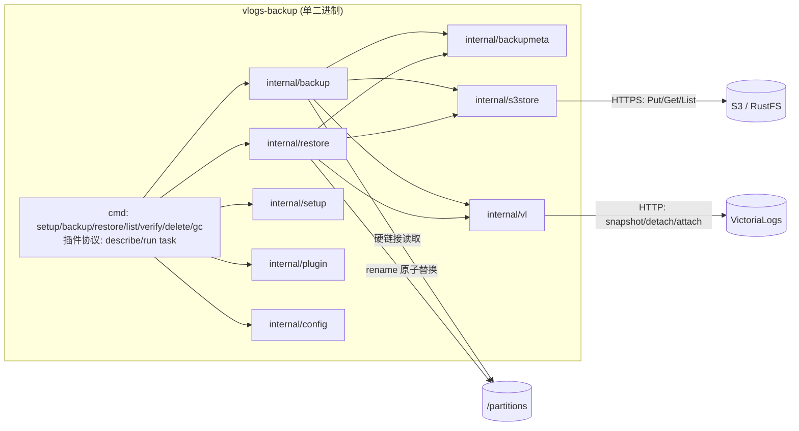
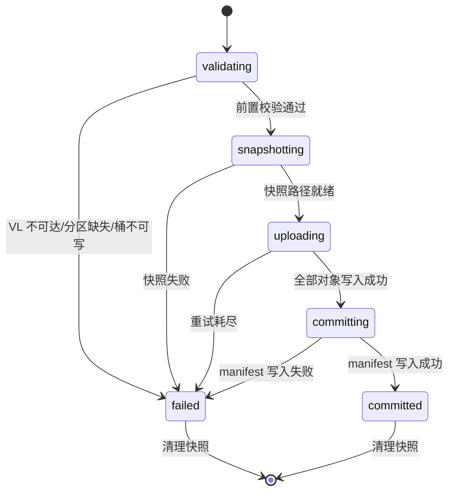
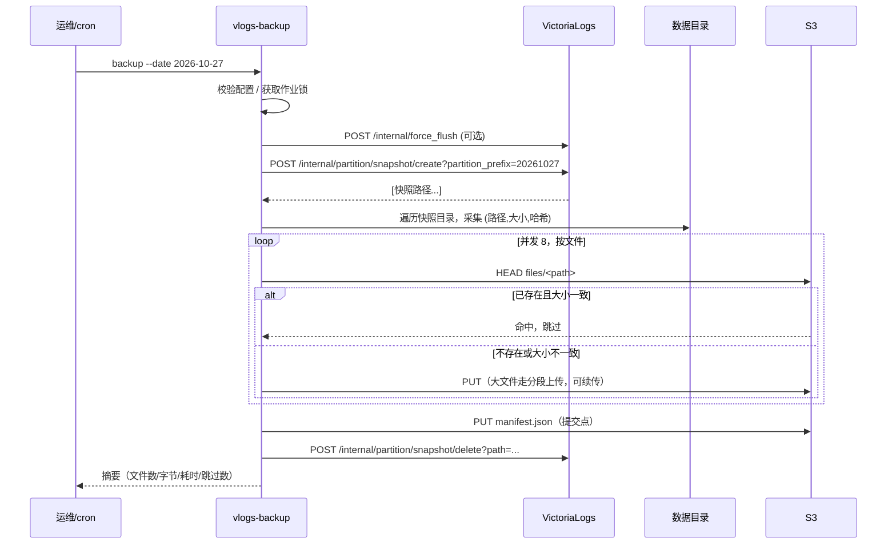
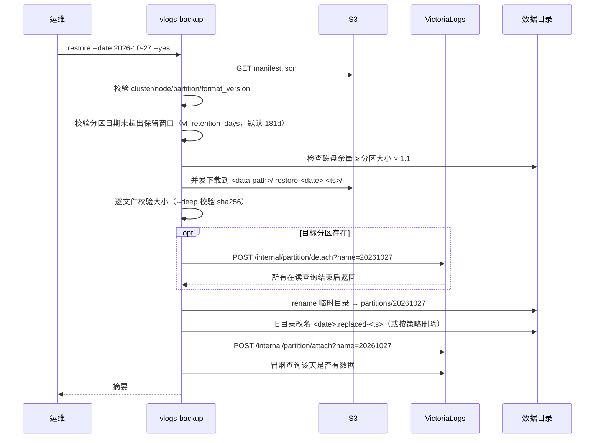
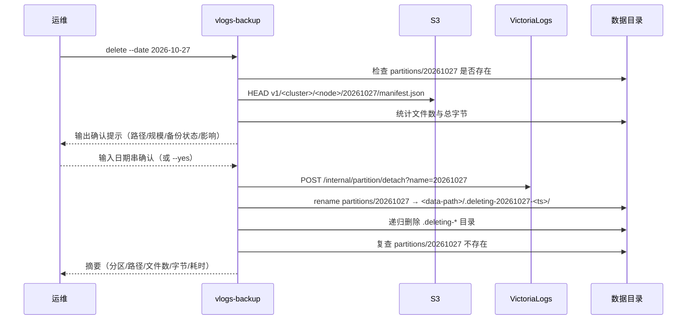

# VictoriaLogs 不停机备份 / 恢复工具 —— 设计文档

| 项目 | 内容 |
| --- | --- |
| 文档版本 | v0.1（待评审） |
| 状态 | Draft |
| 交付物 | 单一 Go 二进制 `vlogs-backup` |
| 目标平台 | linux/amd64、linux/arm64、windows/amd64、windows/arm64（静态链接，`CGO_ENABLED=0`） |
| 目标读者 | SRE、平台研发、AI 编码 agent |
| 关联文档 | [AGENTS.md](../../AGENTS.md)、[spec.md](../../specs/vlogs-backup/spec.md) |

---

## 1. 背景与问题

VictoriaLogs（下称 VL）的数据以 UTC 天为单位落到 `<storageDataPath>/partitions/<YYYYMMDD>`，每个分区自包含且内部文件不可变。这意味着：

1. 日志只有一份在线副本，分区目录损坏或被误删即不可恢复；
2. `-retentionPeriod` 到期后分区会被物理删除，超出保留期的数据无从查找；
3. 现有备份手段只有「整库停服冷拷贝」，与「日志不能中断」的运维要求直接冲突；人工 `rsync` 到远端机器缺少完整性证据，无法回答「2026-10-27 那份备份到底能不能用」。

因此需要一个工具：**以分区为粒度、在服务持续运行的前提下**把历史日志备份到 S3 兼容对象存储，并能**按指定日期**在线回灌。

## 2. 目标与非目标

### 2.1 目标

| 编号 | 目标 | 可观察的完成判定 |
| --- | --- | --- |
| G1 | 在线备份，不重启 VL 进程 | 备份期间其他日期的写入与查询成功率不受影响 |
| G2 | 备份到 S3 兼容存储 | 桶中出现带 `manifest.json` 的完整备份单元 |
| G3 | 按天在线恢复 | 目标日期数据可查询，进程未重启，其他日期无变化 |
| G4 | 备份可信 | `verify` 能给出文件数、字节数、哈希一致性结论 |
| G5 | 失败可回滚、可续传 | 任一步失败后实例状态回到可用；重跑不产生脏数据 |
| G6 | 便于运维自动化 | 稳定退出码 + `--json` 输出，可直接接 cron 告警 |

### 2.2 非目标

- 日志内容解析、字段级筛选、单条日志恢复（恢复粒度固定为整天）；
- 跨版本数据格式转换或重写；
- 时间点恢复（PITR）、跨天分区合并；
- 多目标桶双写（P0 只支持单目标）；
- 通用 S3 备份编排平台，不做多租户与配额管理。

## 3. 术语与核心模型

| 术语 | 定义 |
| --- | --- |
| 分区（Partition） | `partitions/YYYYMMDD`（UTC 日）。备份/恢复的最小单位。 |
| 快照（Snapshot） | VL 为某分区生成的硬链接视图，秒级完成、几乎不额外占空间。仅作业期间存在。 |
| 备份单元（Backup Unit） | 某节点某一天在 S3 上的对象集合：`files/` 下数据文件 + 一个 `manifest.json`。 |
| 提交点（Commit） | `manifest.json` 上传成功即为提交。无 manifest 的前缀一律视为未完成备份。 |
| 节点（Node） | 单机部署即实例本身；集群部署为每个 `vlstorage`。仓库以节点为命名空间。 |
| 恢复点（Restore Target） | 被替换的目标分区目录；替换前可保留为 `<YYYYMMDD>.replaced-<ts>` 以便回滚。 |
| 备份单元键 | `<cluster>/<node>/<YYYYMMDD>`，全局唯一标识一个可恢复单元。 |

## 4. 整体架构



分层职责：

| 层 | 包 | 职责 | 不做什么 |
| --- | --- | --- | --- |
| 入口层 | `cmd/vlogs-backup` | 参数解析、确认交互、退出码映射、输出格式；插件协议入口（`describe` / `run <task>`，JSON→argv 翻译与信封包装） | 不写业务逻辑 |
| 编排层 | `internal/backup`、`internal/restore` | 作业状态机、步骤编排、回滚 | 不直接拼 HTTP 请求 |
| 契约层 | `internal/backupmeta` | 备份单元描述、完整性声明、版本兼容（旧名 `internal/manifest`） | 不做 IO |
| 契约层 | `internal/plugin` | 插件协议（OPS-PLUGIN-1）结构体与常量：manifest v1、task 信封、环境变量名 | 不做 IO |
| 访问层 | `internal/vl`、`internal/s3store` | 端点调用、键布局、重试、分片上传 | 不感知业务语义 |
| 配置层 | `internal/config` | 多来源配置合并、凭据解析、校验 | 不落盘明文凭据 |

## 5. 关键设计决策

| # | 决策 | 备选方案 | 选择理由 |
| --- | --- | --- | --- |
| D1 | 备份粒度 = 天分区 | 整库快照 / 日志流式导出 | 分区自包含且不可变，天然支持单天校验、单天回灌、断点续传；整库快照无法在线且无法单天恢复 |
| D2 | 一致性来自 VL 分区快照，而非直接拷目录 | 直接 `cp`/`rsync` 分区目录 | 直接拷会读到半写入的 part，产生不可用副本 |
| D3 | 提交点 = `manifest.json` 最后写入 | 用 `_SUCCESS` 空文件 / 目录列全即视为成功 | manifest 同时提供完整性声明（文件、大小、哈希），既做提交又做校验源 |
| D4 | S3 上保留分区内相对路径 | tar/zip 归档 | 恢复零转换；单文件为不可变单元，支持并行与文件级续传；无需实现归档格式解析 |
| D5 | 恢复采用「同盘临时目录 + rename 原子替换」 | 直接解压覆盖目标目录 | 覆盖过程中目录处于半成品状态，进程崩溃即损坏；rename 保证目录要么旧要么新 |
| D6 | 恢复走 detach → 替换 → attach | 停进程 | 单天回灌不影响其他日期读写；detach 会等待在读查询结束，语义安全 |
| D7 | 文件级幂等（HEAD 比对大小后跳过） | 每次都全量重传 | 分区文件不可变，大小一致即可判定同一对象；大幅降低重跑成本 |
| D8 | 仓库强制含 `cluster/node` 命名空间 | 只按日期存放 | 集群下数据分散在各 `vlstorage`，混放会导致恢复出的「一天」不完整 |
| D9 | 退出码语义化 + `--json` | 只靠日志 grep | 便于 cron/告警系统稳定判定失败类型，避免误报 |
| D10 | `delete` 只管本地分区，`gc` 只管 S3，二者不共用代码 | 一个命令统管本地+远端删除 | 两者对象不同、可逆性不同、确认强度不同；混在一起会让「删备份」和「删在线数据」互相污染权限与确认逻辑 |
| D11 | 删除本地分区先 `rename` 出 `partitions/` 再递归删 | 直接 `os.RemoveAll(partitions/<date>)` | 目录删除非原子；崩溃会留下残缺目录，VL 重启后自动 attach 造成数据损坏 |
| D12 | 鉴权经 vmauth，支持 `none`/`basic`/`bearer` 三种模式，配置驱动 | 写死某一种鉴权 header | 生产部署在 VL 前置 vmauth；两种标准模式（Basic Auth / Bearer Token）覆盖现有部署，模式与凭据全部来自配置与 credentials（Q1 已决） |
| D13 | 冷热分层是**使用者的调度业务方案**，不是内置流水线：工具只提供独立原子能力（`backup` / `restore` / `delete` / `gc`），30 天本地保留窗口与冷层落位序列由调用方/调度侧编排 | 把分层生命周期做成内置自动流水线 | 调度节奏、窗口长短因业务而异，内置流水线会绑死运维弹性；工具只需保证每个原子命令自身安全（如 `delete` 的备份护栏）（Q4 已决，见 §7.7） |
| D14 | 跨平台目标：Linux/Windows × amd64/arm64 四平台交叉编译 | 仅 Linux | 需求方部署环境包含 Windows；构建保持 `CGO_ENABLED=0` 纯 Go（Q6 已决） |

## 6. 数据模型

### 6.1 S3 仓库布局（format v1）

```text
s3://<bucket>/<prefix>/v1/
└── <cluster>/<node>/<YYYYMMDD>/
    ├── manifest.json           # 提交点，最后写入
    └── files/                  # 快照根相对路径原样保留
        ├── indexdb/...
        └── datadb/...
```

约束：

- 前缀中 `v1` 为格式版本，出现不兼容变更时升级并保留旧版本读取能力；
- 对象键不含分区绝对路径，恢复时可自由选择目标 `--data-path`；
- 未完成前缀（无 manifest）不允许被 `restore` 使用，仅允许被 `gc` 清理；
- **兼容策略（2026-10-29）**：manifest `entries[].path` 语义由早期设计稿的 `partName/...` 修正为快照根相对路径（`indexdb/...`、`datadb/...`，与 VL 快照目录结构一致，见 §9）。`format_version` 保持 `1` 不升级：早期实现按错误假设解析快照基名为分区日期，在真实 VL（快照基名是快照名而非日期）下不可能产生已提交的备份，因此不存在需要兼容的旧仓库。

### 6.2 manifest schema

```json
{
  "format_version": 1,
  "cluster": "prod-logs",
  "node": "vlstorage-0",
  "partition": "20261027",
  "created_at": "2026-10-28T01:12:03Z",
  "snapshot_at": "2026-10-28T01:11:58Z",
  "vl_version": "v1.x.x",
  "tool_version": "0.1.0",
  "file_count": 2,
  "total_bytes": 3145728,
  "entries": [
    { "path": "indexdb/metaindex.bin", "size": 1048576, "sha256": "…" },
    { "path": "datadb/smallparts/16A9C298143BD0A8-1747.bin", "size": 2097152, "sha256": "…" }
  ]
}
```

| 字段 | 必填 | 说明 |
| --- | --- | --- |
| `format_version` | 是 | 不兼容时拒绝恢复，退出码 5 |
| `cluster` / `node` | 是 | 与请求参数比对，防止错节点恢复 |
| `partition` | 是 | `YYYYMMDD`，与目录名、请求 `--date` 三方一致 |
| `created_at` / `snapshot_at` | 是 | 提交时间与快照时间，用于审计与排障 |
| `vl_version` / `tool_version` | 是 | 版本追溯 |
| `file_count` / `total_bytes` | 是 | 快速一致性检查，不必下载即可比对 |
| `entries[].path` | 是 | 快照根相对路径（`indexdb/...`、`datadb/...`），S3 键为 `files/<path>` |
| `entries[].size` | 是 | 默认校验依据 |
| `entries[].sha256` | 是 | `--deep` 校验依据 |

### 6.3 状态机

备份作业：



分区在恢复过程中的状态：

| 状态 | 含义 | 允许迁移 |
| --- | --- | --- |
| `present` | 正常运行态（可能不存在该分区） | → `detached` |
| `detached` | 已从查询/写入范围摘除 | → `replaced`、回退 `present` |
| `replaced` | 目录已原子替换 | → `attached`、回滚 `present` |
| `attached` | 重新挂载 | 终态 |

硬规则：**任一失败分支必须把分区退回 `present`**，无论新数据是否已就位。

本地删除（`delete`）的分区状态：`present` → `detached` → `removed`（终态，分区不存在，属 VL 正常状态）。唯一允许的回退是「detach 成功、rename 之前失败」→ `attach` 回 `present`；进入 `removed` 后不再 attach。

## 7. 核心流程

### 7.1 备份时序



关键顺序约束：

1. **先 flush 再快照**（可选）——快照只覆盖已落盘 data parts，最近约 1 秒内存缓冲不在其中；对当天分区备份时建议强制 flush 并在摘要中提示差异。
2. **先数据后 manifest**——manifest 是提交语义的唯一载体，提前写入会产生「看起来完整实际残缺」的备份。
3. **替换模式必须先传后删**——重新备份同一天时，先上传新对象并写入新 manifest，再清理旧 manifest 中不再被引用的对象，禁止先删后传。

### 7.2 恢复时序



### 7.3 失败回滚矩阵

| 失败点 | 现场状态 | 回滚动作 |
| --- | --- | --- |
| 下载/校验阶段 | 目标分区未动 | 删除临时目录，原状态不变 |
| detach 之后、rename 之前 | 分区已摘除，目标目录仍在 | 直接 attach 原目录 |
| rename 之后、attach 之前 | 新目录已就位，旧目录已改名 | 回滚：旧目录改回原名 → attach；无旧目录则 attach 新目录 |
| attach 失败 | 目录正确但未挂载 | 重试 attach；仍失败则输出人工命令（含绝对路径） |
| 回滚自身失败 | 不确定 | 立即终止后续步骤，输出「当前目录状态 + 两条可选人工命令 + 数据风险说明」，退出码 1 |

原则：**回滚不追求「恢复原样」，而追求「不存在半可用状态」**。宁可停在「分区缺失 + 明确人工指引」，也不要 attach 一个半成品目录。

### 7.4 GC 流程

`gc` 聚焦清理**无 manifest 的未完成前缀**（上次作业中断的残留）；按保留期删除过期单元已移交 S3 桶生命周期规则（见 §7.7）。

1. 列举 `<cluster>/<node>/` 下日期前缀；
2. 无 manifest 的前缀：按对象最后修改时间 + `--stale-after`（默认 24h）判定为未完成，纳入待清理清单；
3. 含 manifest 的完整单元**不在 `gc` 默认范围**——它们可能正被生命周期规则管理或仍属保留窗口；人工确认必须移除时，走 `prune.DeleteUnit()` 并保持「先删 manifest 后删数据」顺序；
4. 默认 `--dry-run` 只输出将删除的对象清单；`--yes` 才执行。

### 7.5 本地分区删除流程（`delete`）

`delete` 删除的是**本地在线数据**（`partitions/<YYYYMMDD>`），用于提前释放磁盘、按合规要求抹除某天日志。它与 `gc` 职责正交：

| | `delete` | `gc` |
| --- | --- | --- |
| 作用对象 | 本地 `partitions/` | S3 备份对象 |
| 触发 | 人工执行，逐次确认 | 策略批量，cron 自动 |
| 可逆性 | **不可恢复** | 可重新备份 |



#### 确认提示（硬要求）

**在执行任何删除动作之前**，必须先输出确认提示。提示必须包含以下字段，缺一不可：

```text
即将删除本地分区数据，此操作不可恢复
  分区        : 2026-10-27 (UTC)
  目录        : /var/lib/victoria-logs/partitions/20261027
  规模        : 12438 个文件 / 58.3 GiB
  在线备份    : 无（s3://logs-backup/vlogs/v1/prod/vlstorage-0/20261027 无 manifest）
  影响        : 该日日志将立即不可查询；其他日期不受影响；进程不重启
  可恢复性    : 无备份，删除后无法找回

请输入 2026-10-27 确认删除，其他任意输入取消:
```

- 交互环境：要求用户**输入完整日期串**（不是 `y/n`），输入不匹配即取消，退出码 7；
- 非交互环境（无 TTY）：必须显式 `--yes`，否则直接拒绝并退出码 2；
- `--dry-run` 时只打印提示与规模统计，不进入确认流程；
- `--json` 模式下，确认提示走 stderr，stdout 仍只输出一行结果。

#### 执行规则

1. **必须先 detach 再动目录**。VL 正在读该分区时直接删目录会产生未定义行为；detach 会阻塞到在读查询结束。
2. **必须 rename 出 `partitions/` 再递归删除**。删除大目录不是原子操作，若中途崩溃，VL 重启会扫描 `partitions/` 并 attach 一个残缺目录。先 `rename` 到 `<data-path>/.deleting-<date>-<ts>`（同文件系统，原子），再从该位置删除，保证 `partitions/` 下任何时刻只有完整目录。
3. **删除后不 attach**。目标状态就是「该分区不存在」，VL 对此是正常状态。
4. **无备份时需二次授权**。若 S3 上该天无已提交备份，除确认提示外还需 `--force-no-backup`，否则拒绝执行（退出码 6）。这是防止「删了本地又没备份」的唯一护栏。
5. **禁止删除 UTC 今天的分区**。仍会有日志写入，删除会造成持续缺口；确需执行必须 `--force-today`。
6. **区间删除逐天独立**。`--from/--to` 下每天单独确认、单独执行；交互模式下不允许一次确认批量删除。
7. **启动时清理 `.deleting-*` 残留**，与孤立快照清理同属启动自检。

#### 失败处理

| 失败点 | 现场状态 | 动作 |
| --- | --- | --- |
| detach 失败（分区在线但端点异常） | 分区仍在线，目录未动 | 直接失败，不回滚，退出码 3 |
| detach 成功、rename 前失败 | 分区已摘除，目录仍在 | **必须 attach 回来**，退出码 1 |
| rename 成功、删除中失败 | 目录已移出 `partitions/`，残留 `.deleting-*` | 不回滚（已开始删除，无一致性保证），日志提示「残留目录可手工删除」，退出码 1 |
| 复查发现分区目录仍存在 | 不确定 | 退出码 1 + 输出绝对路径与人工处置命令 |

原则与恢复一致：**宁可停在「分区缺失 + 明确指引」，也不留一个半成品目录在 `partitions/` 下**。

### 7.6 孤立快照清理

进程被强杀时快照无法在 `defer` 中清理，因此每次作业启动前执行：

1. 列举 VL 侧现存快照；
2. 过滤出「属于本工具命名规范 + 存在时长超过阈值（默认 2h）」的快照；
3. 未持有对应作业锁的快照判定为孤立，删除并告警。

不提供「长期保留快照」作为常规用法：`--keep-snapshot` 仅供排障，且必须在摘要中显式提示其占用空间不会随保留策略释放。

### 7.7 数据生命周期（冷热分层）

冷热分层是**使用者的调度业务方案，不是二进制内置的固定流水线**（Q4 已决）。本工具定位：**只提供独立、可单独调用的原子能力，不内置绑定完整串行工作流**——每个子命令自身原子、自带护栏，分层链路如何编排、何时编排，全部由调用方/调度侧（cron、脚本、调度平台）决定。

调度侧参考的分层模型：

| 层 | 时间范围（UTC） | 存放位置 | 管理方 |
| --- | --- | --- | --- |
| 热层 | 0 ~ 30 天 | 本地 `partitions/`，正常读写 | VL；**30 天本地保留窗口由调用方/调度侧控制**（定期调 `delete` 清出窗口） |
| 冷层 | 30 ~ 181 天 | 仅 S3 备份单元 | 调度侧按需调 `restore` 回灌 |
| 淘汰层 | > 181 天 | 无（S3 对象被生命周期规则删除） | S3 Bucket 生命周期 |

冷层落位的参考操作序列（调度侧编排；先备份、后删除，顺序不可颠倒）：

```text
vlogs-backup backup --date <X>   # 快照 → 上传 S3 → manifest 提交（成功后命令才退出 0）
vlogs-backup delete --date <X>   # detach → rename 出 partitions/ → 递归删除
```

护栏：`backup` 以退出码 0 表示 manifest 已提交；`delete` 在该天无已提交备份时拒绝执行（R-DEL-07）——两个原子命令的护栏共同保证调度侧即使编排失误，也不可能「先删后丢」。

关键约束：

1. **VL `-retentionPeriod` 必须 ≥ 181d，禁止设置为 30d**。`retentionPeriod` 是 VL 原生 GC 规则：超出窗口的挂载分区会被后台自动删除，同时拦截超出窗口的写入；若设为 30d，30~181 天的分区 attach 恢复后会被 VL 直接 GC，冷层恢复功能失效。
2. **本地 30 天清理由调度侧调用本工具 `delete` 实现**，禁止依赖 VL retention 自动清理本地分区；`retentionPeriod` 仅作为全局兜底时间上限。
3. **>181 天的淘汰交给 S3 Bucket 生命周期规则**。`gc` 不再承担按保留期删除过期单元的主要职责，主要清理无 manifest 的未完成前缀，避免与生命周期规则产生双重删除语义。
4. **恢复前置校验**：`restore` 拒绝「分区日期早于 `now(UTC) - vl_retention_days`（默认 181）」的目标，退出码 6——超出窗口的数据按策略已淘汰，强行恢复必然失败或产生残缺分区。
5. 所有日期判断统一 UTC，对齐 VL 按 UTC 天分区（`YYYYMMDD`）。

## 8. 模块设计

### 8.1 接口定义

```go
type Snapshotter interface {
    Create(ctx context.Context, partition string) ([]string, error)
    Delete(ctx context.Context, path string) error
    List(ctx context.Context) ([]SnapshotInfo, error)
}

type PartitionManager interface {
    Detach(ctx context.Context, partition string) error
    Attach(ctx context.Context, partition string) error
    ForceFlush(ctx context.Context) error
}

type ObjectStore interface {
    Head(ctx context.Context, key string) (ObjectMeta, bool, error)
    Put(ctx context.Context, key string, r io.Reader, size int64) error
    Get(ctx context.Context, key string, w io.WriterAt) error
    List(ctx context.Context, prefix string) ([]ObjectMeta, error)
    Delete(ctx context.Context, key string) error
}
```

设计约束：

- `ObjectStore.Get` 使用 `io.WriterAt`，支持并发下载同一文件的分段，也避免大文件整体载入内存；
- `Put` 接受已知 `size`，用于决定是否走分段上传；
- 所有方法都接收 `context`，重试在实现层完成，编排层只感知最终错误。

### 8.2 包职责细化

| 包 | 关键类型 | 说明 |
| --- | --- | --- |
| `internal/config` | `Config`、`Load()` | flag > `VLB_*` 环境变量 > 配置文件；启动即校验并给出明确错误 |
| `internal/setup` | `Wizard`、`Prompter` | 交互式初始化向导：逐项询问、连通性验证、渲染并写入 `config.toml` 与 `credentials`；输入经由 `Prompter` 接口注入，便于测试 |
| `internal/vl` | `Client` | 端点封装、鉴权头注入、5xx 退避重试、响应解析 |
| `internal/s3store` | `Store` | `KeyBuilder` 统一生成键；分段上传阈值与分片大小可配 |
| `internal/backupmeta` | `Manifest`、`Parse()`、`CheckVersion()` | S3 备份单元 manifest 结构定义、版本兼容、完整性校验（旧名 `internal/manifest`，2026-10 为避免与插件 manifest 重名而更名）；纯结构体，禁止 import IO 包 |
| `internal/plugin` | `Manifest`、`Envelope`、`ErrorInfo`、`ParseHandshake()`、`IsPluginEnv()` | 插件协议（OPS-PLUGIN-1）纯结构体与常量：插件 manifest v1 结构与校验、task 输出信封与错误码、`OPS_PLUGIN_*` 环境变量名、握手行解析；协议规范见 `docs/plugin/`；纯结构体，禁止 import IO 包 |
| `internal/errs` | `Error`、`ExitCode()` | 退出码契约常量（§11.2）与错误分类构造器；`ExitCode(err)` 从错误链提取退出码；纯函数，禁止 import 任何 IO 包 |
| `internal/backup` | `Job` | 状态机与步骤编排，负责快照清理与摘要生成 |
| `internal/restore` | `Job` | 状态机、磁盘预检、临时目录、原子替换、回滚 |
| `internal/purge` | `Job`、`Confirmer` | 本地分区删除：detach → rename → 递归删除 → 复查；负责确认提示渲染 |
| `internal/prune` | `GCJob`、`DeleteUnit()` | S3 备份单元清理（gc 专用）：扫描无 manifest 的 stale 前缀并清理；删除顺序为先 manifest 后数据 |
| `internal/verify` | `Job` | 备份单元在线清单与校验：`List` 扫描本节点键空间收集已提交单元（仅含 manifest 的前缀，按分区升序）；manifest 存在性与版本、逐对象 size 比对、`--deep` 全量 sha256 |
| `internal/lock` | `FileLock` | 基于本地锁文件的 `cluster/node/date` 互斥 |
| `internal/report` | `Summary` | 表格与 JSON 两种渲染 |

### 8.3 并发模型

- 文件级 worker pool，默认 8，上限受内存与 S3 连接数约束；
- 每个 worker 独立处理「HEAD → PUT/GET → 校验」，单文件失败只影响自身；
- 错误收集使用 `errgroup`，任一失败即取消 `context`，但**已上传对象保留**（幂等前提）；
- 恢复时下载与校验可流水线化：下载完成即校验，不等待全量完成。

### 8.4 第三方依赖选型（2026-10-28 定）

| 依赖 | 用途 | 理由 |
| --- | --- | --- |
| `github.com/BurntSushi/toml` | 配置/credentials 解析 | Go 生态 toml 解析事实标准，纯 Go |
| `golang.org/x/sync/errgroup` | 并发错误收敛 | §8.3 并发模型指定；官方扩展库，纯 Go |
| `golang.org/x/term` | setup 向导的密码输入 | 读单个秘密值时不回显（`term.ReadPassword`，R-SU-03）；官方扩展库，纯 Go，不破坏四平台交叉编译 |
| `golang.org/x/sys` | `x/term` 的底层平台实现依赖 | 间接依赖，同样纯 Go |
| `github.com/aws/aws-sdk-go-v2`（核心 / `credentials` / `service/s3`） | `internal/s3store` 的 S3 访问 | 见下 |

**S3 SDK：aws-sdk-go-v2（选定）**

- 生产对象存储为 **RustFS**：完整兼容 S3 协议与 SigV4 签名，默认 path-style 寻址，region 默认 `us-east-1`，AWS 官方 SDK 将 endpoint 指向 RustFS 即可直连，无需适配层；
- AWS 官方长期维护（版本支持矩阵 GA 状态），纯 Go、无 CGO，不破坏四平台交叉编译（§16）；
- `s3.Options.UsePathStyle = true` 与 RustFS 默认寻址行为一致，同样覆盖 MinIO/AIStor/其他自建 S3 兼容端点；region 允许空（占位 `us-east-1`），对齐配置项 §10.1；
- 能力覆盖：`PutObject` 自动 multipart（part size 可配置 → Q2 阈值可配置）、`GetObject` 流式下载到临时目录（→ C4 校验后 rename）、`ListObjectsV2` + `DeleteObjects` 批量删（→ gc）；
- 模块化引入，仅 `aws-sdk-go-v2` 核心 + `credentials` + `service/s3` 三个模块及其官方内部依赖；
- **不引入 `config` 模块**（2026-10-28 实现期裁决）：凭据/端点/region 全部由 `internal/config` 显式注入（`NewStaticCredentialsProvider` + `BaseEndpoint`），无需 SDK 的环境变量/共享配置加载器；少一层隐式读取即少一处凭据意外入日志的风险（C9）。

**否决记录：minio-go/v7**

- MinIO 服务端社区版仓库已于 2026-04-25 归档并停止维护，官方转向专有许可的 AIStor；minio-go SDK 截至本决策时点仍活跃，但「服务端归档 → SDK 跟进停更」的先例风险真实存在，对备份工具不可接受；
- 依赖「不绑死 MinIO 生态」的定位，最终选择协议中立的 AWS 官方 SDK。该决策不改变测试方案（S3 协议稳定，任意兼容实现可用于集成测试，见 §15）。

**VL 侧：零第三方 SDK**

- VictoriaLogs 官方无 Go SDK，管理端点为普通 HTTP API，`internal/vl` 全部使用标准库 `net/http`（`NewRequestWithContext`）+ `net/url` + `encoding/json`；鉴权头按 §9 `AuthInjector` 动态构造，不引库。

## 9. VictoriaLogs 交互契约

| 用途 | 方法与路径 | 关键参数 | 备注 |
| --- | --- | --- | --- |
| 创建快照 | `POST /internal/partition/snapshot/create` | `partition_prefix=YYYYMMDD` 与 `name=YYYYMMDD` **双参数同发** | 返回快照绝对路径数组；支持 `YYYYMM`、`YYYY` 前缀。VL ≥ v1.44.0 按 `partition_prefix` 匹配并忽略 `name`；v1.31~v1.43 只认已废弃的 `name` 参数。双参数保证两个版本区间均可创建 |
| 删除快照 | `POST /internal/partition/snapshot/delete` | `path=<快照路径>` | 必传实际路径，不做前缀猜测 |
| 列举快照 | `POST /internal/partition/snapshot/list` | — | 返回纯 JSON 字符串数组；用于孤立快照清理与能力探测 |
| 列举分区 | `POST /internal/partition/list` | — | 返回纯 JSON 字符串数组；用于能力探测 |
| 摘除分区 | `POST /internal/partition/detach` | `name=YYYYMMDD` | 阻塞至在读查询结束 |
| 挂载分区 | `POST /internal/partition/attach` | `name=YYYYMMDD` | 恢复末尾调用 |
| 强制落盘 | `POST /internal/force_flush` | — | 备份当天分区时建议先调用 |
| 冒烟查询 | `POST /select/logsql/query` | `query=*`、`start`/`end` 为当日 UTC 零点至次日零点 | 恢复 attach 后验证当日数据可查询（R-RS-07）；只读前 64KB 判定非空，失败仅告警 |
| 版本探测 | `GET /metrics` | — | 抓取 `vm_app_version`，失败返回空串并落 `unknown`，不影响作业主流程 |

实现注意：

- 所有管理端点必须使用 `POST`，避免被浏览器/代理误触发；
- **快照路径形态（2026-10-29 实测确认）**：快照目录为 `<dataPath>/partitions/<YYYYMMDD>/snapshots/<snapshotName>/`，基名是 `snapshotutil.NewName()` 生成的快照名（形如 `16A9C298143BD0A8-…`），**不是日期**。分区日期取 `snapshots` 段的父段；工具据此解析 `snapshot/list` 与 `snapshot/create` 返回的路径，并按「快照根相对路径」（`indexdb/...`、`datadb/...`）生成 manifest 条目（见 §6.1 兼容策略）。快照内容镜像分区结构，恢复落位由 manifest 驱动，与快照名无关；
- 生产部署在 VL 前置 **vmauth** 代理，鉴权由 vmauth 完成（Q1 已决）。工具支持三种模式，配置项 `vl_auth_mode` 切换：`none`（无鉴权）、`basic`（`Authorization: Basic base64(user:pass)`）、`bearer`（`Authorization: Bearer <token>`）。实现抽象为 `AuthInjector` 接口，模式与凭据全部来自配置与 `credentials` 文件，**不硬编码任何鉴权方式与 header**；
- 启动时做一次能力探测：若快照或分区管理端点返回 404，直接失败并提示「VL 版本过低」，不进入半途失败。

## 10. 配置与凭据

### 10.1 配置项

配置项全部经 `config.toml` 与 `VLB_*` 环境变量注入；CLI 层只提供 `--config`（附录 A），不提供逐项 flag——避免凭据与端点经命令行回显（C9）。

| 配置 | 环境变量 | 默认 | 必填 |
| --- | --- | --- | --- |
| VL 地址（`vl_url`） | `VLB_VL_URL` | — | 是 |
| VL 鉴权模式（`vl_auth_mode`） | `VLB_VL_AUTH_MODE` | `none` | 否；`none` / `basic` / `bearer`（经 vmauth，见 §9） |
| VL 用户名（`vl_username`） | `VLB_VL_USERNAME` | — | `basic` 模式必填 |
| VL 密码（`vl_password`） | `VLB_VL_PASSWORD` | — | `basic` 模式必填；敏感项，仅落 credentials |
| VL Token（`vl_token`） | `VLB_VL_TOKEN` | — | `bearer` 模式必填；敏感项，仅落 credentials |
| 保留窗口（`vl_retention_days`，天） | `VLB_VL_RETENTION_DAYS` | `181` | 否；restore 前置校验用，须与 VL `-retentionPeriod` 一致（见 §7.7） |
| 数据目录（`data_path`） | `VLB_DATA_PATH` | — | backup/restore/delete 必填 |
| 集群名（`cluster`） | `VLB_CLUSTER` | `default` | 否 |
| 节点名（`node`） | `VLB_NODE` | `default` | 集群部署必填 |
| S3 端点（`s3_endpoint`） | `VLB_S3_ENDPOINT` | — | 是（除 dry-run 外） |
| 桶（`s3_bucket`） | `VLB_S3_BUCKET` | — | 是 |
| 前缀（`s3_prefix`） | `VLB_S3_PREFIX` | `vlogs` | 否 |
| 区域（`s3_region`） | `VLB_S3_REGION` | `us-east-1` 占位 | 视厂商 |
| 路径风格（`s3_path_style`） | `VLB_S3_PATH_STYLE` | `true` | 否 |
| 分段上传阈值（`s3_multipart_threshold`，字节） | `VLB_S3_MULTIPART_THRESHOLD` | `67108864`（64MiB） | 否；Q2：不写死 |
| 分片大小（`s3_multipart_part_size`，字节） | `VLB_S3_MULTIPART_PART_SIZE` | `8388608`（8MiB） | 否；Q2：不写死 |
| 并发（`concurrency`） | `VLB_CONCURRENCY` | `8` | 否 |
| 单文件超时（`io_timeout`） | `VLB_IO_TIMEOUT` | `10m` | 否 |
| 作业总超时（`job_timeout`） | `VLB_JOB_TIMEOUT` | `0`（不限） | 否 |
| 恢复磁盘预检因子（`disk_check_factor`） | `VLB_DISK_CHECK_FACTOR` | `1.1` | 否；要求可用空间 ≥ 分区大小 × 因子（R-RS-02） |
| 孤立快照年龄（`orphan_snapshot_age`） | `VLB_ORPHAN_SNAPSHOT_AGE` | `2h` | 否；超过且未持锁才在启动期清理（§7.6） |

### 10.2 凭据解析顺序

凭据来源只有两条（实现按 §8.4「不引入 SDK config 模块」裁决收敛）：

1. `credentials` 文件（与 `config.toml` 同目录，权限 `0600`）；
2. 显式环境变量（`VLB_S3_ACCESS_KEY` / `VLB_S3_SECRET_KEY` / `VLB_VL_PASSWORD` / `VLB_VL_TOKEN`）。

共享凭据文件（`AWS_SHARED_CREDENTIALS_FILE`）、实例角色 / 工作负载身份（IMDS、OIDC）、匿名访问**均不实现**：S3 客户端构造要求 AK/SK 非空，缺失时以退出码 2 报错并提示用 `setup` 生成凭据。目的是一处显式注入，避免隐式读取导致凭据意外入日志（C9）。

安全规则：

- 凭据永不写入日志、摘要、错误信息，也不回显到终端；
- `config.toml` 不写明文密钥；敏感项（S3 AK/SK、VL 密码、VL Token）统一落在同目录 `credentials` 文件中，权限 `0600`，`Load()` 默认尝试读取 `<config 目录>/credentials`；
- 检测到 `config.toml` 或 `credentials` 被组/其他用户可读时告警；
- 所有出站仅 HTTPS。

### 10.3 setup 子命令生成的配置

`setup` 是唯一的配置文件生成入口，面向首次安装的人工初始化：

```text
/etc/vlogs-backup/
├── config.toml      # 0644：vl_url、vl_auth_mode（none/basic/bearer）、data_path、cluster、node、
│                    #        vl_retention_days、s3_endpoint、s3_region、s3_bucket、s3_prefix、s3_path_style、
│                    #        concurrency（不含任何密钥值）
└── credentials      # 0600：s3_access_key、s3_secret_key、vl_username?、vl_password?、vl_token?
                     #        （按鉴权模式写入对应项；可留空则不写该行）
```

交互流程（固定顺序，逐项给默认值）：

| 步骤 | 询问 | 校验 |
| --- | --- | --- |
| 1 | VL 地址（`http(s)://host:port`） | URL 合法 |
| 2 | VL 鉴权模式（`none` / `basic` / `bearer`）；`basic` 输入 username + password（不回显），`bearer` 输入 token（不回显） | 模式合法；对应凭据非空 |
| 3 | 数据目录（VL `--storageDataPath`） | 绝对路径 |
| 4 | cluster / node | 非空，默认 `default` |
| 5 | S3 endpoint | URL 合法 |
| 6 | S3 region | 允许空（RustFS / MinIO 等可留空） |
| 7 | S3 bucket / prefix | bucket 非空；prefix 默认 `vlogs` |
| 8 | S3 path-style | 默认 `true`（RustFS / MinIO / 自建） |
| 9 | S3 Access Key / Secret Key（不回显） | 必填；写入 credentials（0600）；留空则 backup/restore 等命令失败（退出码 2） |
| 10 | 连通性验证 | 见下 |

规则：

- 目标目录不存在则创建（`0700`）；`config.toml` 已存在时要求输入 `overwrite` 确认，其他输入取消（退出码 7）；
- `--output-dir` 可改变目标目录（默认 `/etc/vlogs-backup`），仅用于测试或非 root 场景；
- `--skip-check` 跳过第 10 步；
- 连通性验证内容：VL 走能力探测（快照 list 端点可达），S3 走 `HeadBucket`；任一失败显示原因并允许「重试 / 重新输入 / 中止」；中止退出码 3，写入文件前验证不通过不落盘；
- 交互输入走 `term.ReadPassword`，凭据不回显；生成的文件与最终摘要中凭据以 `***` 代替；
- 非 TTY 环境直接拒绝（退出码 2），提示改用 flag / 环境变量直接运行；
- 完成后打印下一步示例：`vlogs-backup --config /etc/vlogs-backup/config.toml backup --date 2026-10-27 --dry-run`。

## 11. 可观测性与输出契约

### 11.1 日志字段

`ts`、`level`、`op`（setup/backup/restore/list/verify/delete/gc）、`cluster`、`node`、`partition`、`phase`、`bytes`、`files`、`elapsed_ms`、`err`。

- 人读输出走 stdout，进度与告警走 stderr；
- `--json` 时 stdout 只输出一行结果 JSON，日志仍走 stderr；
- 每个 phase 至少一条起止日志，便于定位卡点。

### 11.2 退出码

| 码 | 含义 | 典型场景 |
| --- | --- | --- |
| 0 | 成功 | — |
| 1 | 未分类错误 / 回滚失败 | 需人工介入 |
| 2 | 参数或配置错误 | 缺必填项、日期格式错 |
| 3 | 远端不可达 / 网络失败 | VL 5xx、S3 超时（可重试） |
| 4 | 目标不存在 | 分区无数据、备份无 manifest |
| 5 | 校验失败 | 大小或哈希不一致、格式版本不兼容 |
| 6 | 前置条件不满足 | 磁盘不足、锁冲突、桶不可写 |
| 7 | 用户取消 | 交互确认拒绝 |

**插件协议退出码映射**（`describe` / `run <task>` 子命令，规范见 `docs/plugin/handshake-protocol.md` §3.3）：
进程以插件协议模式退出时，按上表原始退出码分类映射为协议退出码后返回，属于协议层翻译，不改变上表语义本身：

| 协议退出码 | 来源（§11.2 原始码） | 说明 |
| --- | --- | --- |
| 0 | 0 | 成功 |
| 1 | 其他未列举码 | 未分类崩溃 |
| 2 | 2、7 | 输入错误（INPUT_INVALID） |
| 3 | 1、3、4、5、6 | 执行失败（EXEC_FAILED）；网络类（3）标 `retryable=true` |
| 4 | — | 权限拒绝（当前工具不产生） |
| 124 | — | 超时（由底座强杀产生，工具自身不返回） |

### 11.3 摘要内容

备份：分区、文件数、总字节、跳过对象数、耗时、快照是否已清理。
恢复：分区、替换文件数、总字节、耗时、旧目录保留路径、冒烟查询结果。
删除（本地）：分区、分区绝对路径、文件数、删除字节、是否已有在线备份、耗时。
清理（S3）：删除单元数、删除对象数、删除字节、残留对象数、耗时。

## 12. 错误处理与重试

| 错误类别 | 重试策略 | 上限 |
| --- | --- | --- |
| 网络超时、连接重置 | 指数退避 + jitter，初始 500ms | 5 次 |
| S3 5xx、`SlowDown` | 指数退避 | 8 次 |
| VL 5xx | 指数退避 | 5 次 |
| 4xx（鉴权、参数、404） | 不重试 | — |
| 校验不一致 | 不重试，直接失败 | — |
| 锁冲突 | 不重试 | — |

规则：重试只在访问层实现；编排层的任何失败都必须携带「发生了什么 + 当前状态 + 建议下一步」。

## 13. 安全设计

| 面向 | 措施 |
| --- | --- |
| 高危操作 | `restore`、`gc`、`delete` 在非交互环境必须 `--yes`；`delete` 交互环境必须输出含「分区 / 目录 / 规模 / 备份状态 / 影响 / 可恢复性」的确认提示，并要求输入完整日期串（见 §7.5），不可用 `y/n` 代替；`restore` 交互环境回显将被替换的绝对路径与文件数 |
| 最小权限 | VL 侧只需分区读 + 管理端点；S3 侧需 `ListBucket`、`GetObject`、`PutObject`、`HeadObject`、`DeleteObject` 及分段上传权限 |
| 凭据 | 不打印、不写入 manifest、不进日志与命令行回显；`config.toml` 不含明文密钥，敏感项仅允许 `setup` 写入同目录 `credentials`（0600，见 §10.3） |
| 路径安全 | 恢复目标必须在 `--data-path/partitions/` 之下，拒绝 `..` 与符号链接穿越 |
| 误操作防护 | 恢复「今天」分区强制二次确认并提示实时日志缺口风险；节点名不匹配默认拒绝，需 `--allow-node-mismatch`；恢复前校验分区日期未超出保留窗口（`vl_retention_days`，默认 181d，见 §7.7），超出直接拒绝（退出码 6）——防止 attach 后被 VL 原生 GC 回收，制造数据看似恢复实则丢失的事故 |
| 数据完整性 | manifest 作为唯一完整性声明；恢复前必校验，恢复后可冒烟查询 |

## 14. 性能与容量

| 维度 | 设计 |
| --- | --- |
| 吞吐 | 文件级并发 + 分段上传；瓶颈通常在单连接带宽，并发默认 8 可在实测后调整 |
| 内存 | 流式读写，单文件不整体载入；内存 ≈ 并发数 × 缓冲区（默认 1MiB × N） |
| 快照成本 | 硬链接，秒级且几乎不占额外空间；但**保留策略删除分区时快照仍占空间**，必须及时清理 |
| 恢复磁盘 | 需要 ≈ 分区大小 × 1.1（含临时目录与旧目录保留）；不足时前置失败，不开始下载 |
| 容量假设 | 单日分区典型规模约十几 GB，不同业务场景波动较大；**不写死容量阈值**，分段上传阈值、磁盘预检系数等均做成可配置参数，上线前用现网分区实测校准（Q2 已裁决，见 §18） |

## 15. 测试策略

| 层级 | 方法 | 覆盖点 |
| --- | --- | --- |
| 单元 | 表驱动 | manifest 校验、键布局、日期/时区换算、退出码映射 |
| 契约 | `httptest` 模拟 VL 端点 | 快照创建/删除返回结构、detach 阻塞语义、404 能力探测 |
| 集成 | S3 兼容容器（RustFS 优先——生产同款；备选 MinIO 归档镜像 / SeaweedFS / Garage） | 上传/下载/续传/幂等/分段上传/GC |
| 故障注入 | 包装 `ObjectStore` 与 `PartitionManager` 强制返回错误 | 每个失败点的回滚路径（尤其是 rename 后 attach 失败） |
| 端到端 | 本地 VL + S3 兼容容器（同上） | 造数 → 备份 → 删除分区 → 恢复 → 查询验证 |

> 注：生产对象存储为 RustFS（S3 兼容、SigV4、默认 path-style），集成测试优先使用 RustFS 容器以保证与生产行为一致。MinIO 服务端社区版已于 2026-04 归档（见 §8.4），归档镜像或 SeaweedFS/Garage 可作备选——S3 协议稳定，任意兼容实现均有效。

硬性要求：**回滚路径必须逐条有测试**，这是本工具唯一可能造成数据损失的代码区域。

## 16. 构建与发布

- `CGO_ENABLED=0`，交叉编译四平台：`linux/amd64`、`linux/arm64`、`windows/amd64`、`windows/arm64`；
- 产物 `vlogs-backup_<version>_<os>_<arch>[.exe]` + `sha256sum`（Windows 产物带 `.exe` 后缀）；
- 版本注入：`-ldflags "-X main.version=… -X main.commit=… -X main.buildTime=…"`；
- `version` 子命令输出工具版本、commit、构建时间、Go 版本；
- 发布说明必须写明仓库 `format_version`；不兼容变更需升版本并给旧版本读取兼容期；
- 质量门禁：`gofmt`、`go vet`、`golangci-lint`、`go test -race`。

## 17. 运维手册要点

```bash
# 首次安装：交互式生成 /etc/vlogs-backup/{config.toml,credentials}
vlogs-backup setup

# 每日备份（cron），失败以非 0 退出码告警
0 2 * * * /usr/local/bin/vlogs-backup --config /etc/vlogs-backup/config.toml backup --latest 1 --json >> /var/log/vlogs-backup.log 2>&1

# 补备份指定区间
vlogs-backup backup --from 2026-10-01 --to 2026-10-07 --cluster prod --node vlstorage-0

# 恢复某天（高危，需确认）
vlogs-backup restore --date 2026-10-27 --node vlstorage-0 --yes

# 审计前校验
vlogs-backup verify --date 2026-10-27 --deep

# 删除本地某天分区（高危：不可恢复，先看提示再输入日期确认）
vlogs-backup delete --date 2026-10-27
vlogs-backup delete --date 2026-10-27 --dry-run          # 只看规模，不进确认
vlogs-backup delete --from 2026-10-01 --to 2026-10-03 --yes  # 非交互，逐天删

# 冷层落位（调度侧编排示例：备份成功后才删本地，见 §7.7）
vlogs-backup backup --date 2026-09-28 --yes && \
vlogs-backup delete --date 2026-09-28 --yes

# 清理 S3 上无 manifest 的未完成前缀（默认 dry-run）
vlogs-backup gc --stale-after 24h --dry-run
```

约定：

- 冷热分层（热 0~30d / 冷 30~181d / 淘汰 >181d）是**调度侧的编排方案**，不是工具内置流水线；本工具只提供原子命令，30 天窗口清理由调度侧定期调 `delete --from/--to` 实现（见 §7.7）；
- S3 桶生命周期规则负责淘汰 >181 天的备份对象（含 manifest 与数据）；工具侧不再提供按保留期批量删除过期单元的 `gc` 语义，避免双重删除；
- `gc` 聚焦清理无 manifest 的未完成前缀（上次作业中断的残留）；若需移除含 manifest 的完整单元（人工介入场景），仍必须走 `prune.DeleteUnit()` 的「先删 manifest 后删数据」顺序，保证中断后不会留下「伪完整备份」；
- 过期备份清理靠 S3 生命周期，人工删除本地在线数据用 `delete`；两者对象不同，代码不共用；
- `delete` 只动本地 `partitions/`，**不会**删除任何 S3 备份；若该天无已提交备份，必须显式加 `--force-no-backup` 才允许删除；
- 恢复后必须执行一次 `verify` 与冒烟查询；`*.replaced-*` 目录确认无误后手工清理；
- 集群恢复逐节点执行，`vlselect` 侧无需操作，恢复期间该节点该天数据暂时缺失。

## 18. 风险与未决问题

2026-10-28 全部已由需求方裁决，不再阻塞；残留风险移入「处置」列。

| # | 问题 | 裁决 / 处置 |
| --- | --- | --- |
| Q1 | 分区管理端点鉴权方式 | **已决**：生产 VL 前置 vmauth；支持 `none` / `basic` / `bearer` 三种模式，配置驱动，不硬编码 header（D12、§9、§10.1） |
| Q2 | 单日分区典型大小与文件数 | **已决**：典型约十几 GB，分场景波动；不写死阈值，分段上传阈值、磁盘预检系数等全部做成可配置参数，上线前实测校准（§14） |
| Q3 | 跨账户/跨区域双写 | **已决**：不需要，不实现；保持单目标、单一 manifest 提交点 |
| Q4 | 备份生命周期与 `-retentionPeriod` 关系 | **已决**：冷热分层 0~30/30~181/>181 三层模型，属调度侧编排方案而非内置流水线；`retentionPeriod` 必须 ≥181d 禁止 30d；本地 30 天清理由调度侧调 `delete` 实现；>181d 交 S3 生命周期；详见 §7.7（D13） |
| Q5 | 客户端加密（SSE-C / 自有密钥） | **已决**：不需要，不实现；依赖 S3 服务端加密与传输层 HTTPS |
| Q6 | 目标操作系统与架构 | **已决**：Linux + Windows × amd64 + arm64 四平台交叉编译（D14、§16） |
| R1 | 恢复「今天」分区会丢失实时日志 | 用户误操作导致数据缺口 | 强制二次确认 + 摘要显式告警 |
| R2 | 强杀进程留下孤立快照占盘 | 磁盘缓慢增长 | 每次作业前清理 + 超阈值告警 |
| R3 | S3 侧被外部工具删除对象 | 备份不可用 | `verify` 定期巡检 + 只读策略约束 |

## 附录 A：CLI 一览

```text
vlogs-backup <command> [flags]

  setup      交互式生成配置文件（默认写入 /etc/vlogs-backup/）
  backup     备份一个或多个日期分区
  restore    在线恢复指定日期分区
  list       列出已提交备份
  verify     校验备份完整性
  delete     删除本地指定日期的分区数据（不可恢复，需确认）
  gc         清理 S3 上无 manifest 的未完成备份前缀（过期淘汰交给 S3 生命周期，见 §7.7）
  version    输出版本与构建信息

插件协议（OPS-PLUGIN-1，规范见 docs/plugin/）:
  describe   输出插件 manifest JSON（stdout 单个 JSON 对象；各 task 参数
             schema 与 config schema 的权威来源）
  run        以 task 形态执行子命令: vlogs-backup run <task-name>
             可用 task: backup / restore / list / verify / delete / gc
             （setup 为交互向导、version 无参数，均不提供 task 形态）
             stdin 收 JSON 参数，stdout 出单个信封；退出码映射见 §11.2
```

| flag | 适用 | 默认 | 说明 |
| --- | --- | --- | --- |
| `--config` | 全部 | `/etc/vlogs-backup/config.toml` | 配置文件路径；默认路径不存在时跳过文件层（仅默认值 + `VLB_*`）。其余配置项不经 flag 注入（见 §10.1） |
| `--output-dir` | setup | `/etc/vlogs-backup` | 配置生成目录，仅测试或非 root 场景使用 |
| `--skip-check` | setup | false | 跳过 VL / S3 连通性验证 |
| `--date` | backup/restore/verify/delete | 昨天(UTC) | `YYYY-MM-DD`（也接受 `YYYYMMDD`）；不得与 `--from/--to`、`--latest` 同用 |
| `--from` / `--to` | backup/list/delete | — | 日期区间（含端点），必须成对出现 |
| `--latest` | backup | — | 最近 N 天（含 UTC 今天）；不得与 `--from/--to`、`--date` 同用 |
| `--if-exists` | backup | `skip` | `skip` / `replace` |
| `--on-existing` | restore | `keep` | 旧分区保留（改名为 `<date>.replaced-<ts>`）或删除 |
| `--allow-node-mismatch` | restore | false | 放行 manifest 中 cluster/node 不一致的备份，摘要标注 `cross_node=true`（R-MF-04）；分区日期不一致永远拒绝 |
| `--deep` | verify/restore | false | 启用 sha256 全量比对 |
| `--dry-run` | backup/restore/delete/gc | false | 只读演练，不产生任何变更：backup 仅做能力探测并列出计划分区；restore 仅探测；delete 输出确认提示与规模统计且不进确认流程；gc 缺省即演练。list/verify 本身只读，不提供该 flag |
| `--yes` | restore/delete/gc | false | 非交互确认；`gc` 缺省时等效 dry-run，`delete`/`restore` 缺省时在非 TTY 环境直接拒绝（退出码 2） |
| `--stale-after` | gc | `24h` | 无 manifest 前缀判定为未完成的阈值；不接受按日期批量删除的参数（R-GC-04） |
| `--force-no-backup` | delete | false | 该天无已提交备份时仍允许删除本地分区（额外授权） |
| `--force-today` | delete/restore | false | 允许操作 UTC 今天的分区（实时日志缺口） |
| `--json` | 全部 | false | 机器可读输出：stdout 只出现摘要（单分区/单命令场景为一行 JSON），日志、进度、确认提示一律走 stderr |
| `--keep-snapshot` | backup | false | 排障用，会在摘要中告警 |

交互确认规则（R-DEL-03 / R-RS-08）：

| 场景 | 要求 |
| --- | --- |
| `delete` 非 TTY | 必须显式 `--yes`，缺失即退出码 2；`--dry-run` 不进确认流程 |
| `delete` TTY | 必须输入完整日期串（如 `2026-10-27`）才继续，输入 `y`、空行或错误日期一律取消（退出码 7） |
| `restore` 非 TTY | 必须显式 `--yes`；恢复 UTC 今天分区还必须 `--force-today`（缺失退出码 2） |
| `restore` TTY | 非今天分区输入 `yes` 继续；今天分区输入完整日期串继续（即使已给 `--yes`） |
